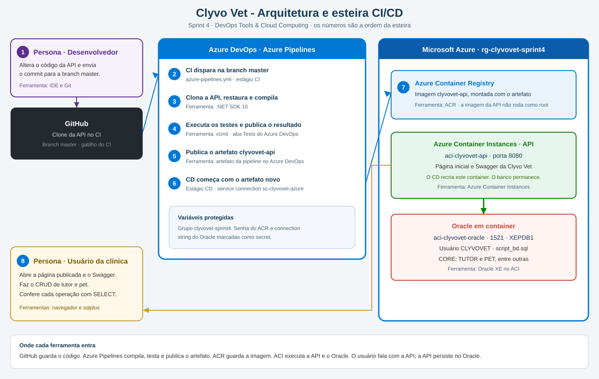

# Clyvo Vet — CI/CD na Azure (Sprint 4)

**DevOps Tools & Cloud Computing**

Grupo: Enzo Vaz (RM 561702) · Lucas Ryuji Fukuda (RM 562152) · Pietro Donella Salomão (RM 561722) · turma 2TDSPF

Repositório: https://github.com/PietroDonella/Devops-Challenge-Clyvet-Sprint4

## O que a aplicação faz

A Clyvo Vet API é o backend em .NET 10 da clínica veterinária Clyvo. Ela registra a jornada do pet: tutores, animais, clínicas, veterinários, consultas e prontuários.

Nesta sprint a mesma API é compilada, testada e publicada por uma esteira no Azure DevOps. O commit na branch `master` dispara o CI. O CD publica a API em um Azure Container Instance. Os dados ficam em um Oracle, também em container na Azure.

O código da API permanece em [EnzoVazz/ClyvoVet](https://github.com/EnzoVazz/ClyvoVet) e não é republicado aqui. A esteira usa a cópia desse repositório no Azure Repos, chamada `ClyvoVet`, na branch `master`. A página inicial e o Swagger mostram o título de `ClyvoVet.Api/AppInfo.cs`. Tutor e pet são as duas tabelas relacionadas do CRUD.

## Stack

| Peça | Tecnologia |
|---|---|
| Aplicação | ASP.NET Core, .NET 10, Entity Framework Core, Oracle |
| Testes do CI | xUnit e Moq, projeto `ClyvoVet.UnitTests` |
| Código da API | Azure Repos `ClyvoVet`, cópia de `EnzoVazz/ClyvoVet` |
| Título da página | `ClyvoVet.Api/AppInfo.cs` no Azure Repos |
| Esteira | Azure DevOps, pipeline `ClyvoVet`, arquivo `azure-pipelines.yml` do Azure Repos |
| Imagem da API | Azure Container Registry, processo sem privilégio de root |
| Execução da API | Azure Container Instance `aci-clyvovet-api`, porta 8080 |
| Banco | Oracle XE em container, ACI `aci-clyvovet-oracle`, serviço `XEPDB1` |
| Grupo de recursos | `rg-clyvovet-sprint4`, região Brazil South |

## Banco de dados

O banco aceito nesta entrega é Oracle em container na nuvem. O DDL, os comentários e a carga inicial estão em `script_bd.sql`. O container do banco aplica esse arquivo na criação.

As tabelas de negócio são `CLINICA`, `TUTOR`, `VETERINARIO`, `PET`, `PRONTUARIO` e `CONSULTA`. O CRUD demonstrado usa `TUTOR` e `PET`, ligadas por `PET.ID_TUTOR`.

A carga já traz linhas de atendimento, entre elas Ana Paula Souza e Bruno Ferreira em `TUTOR`, e Rex e Mia em `PET`. A identity começa em 100. Os registros novos da API recebem id a partir de 100.

O script `criar-banco.sh` cria o grupo de recursos, o ACR e o ACI do Oracle. A esteira não recria o banco: cada deploy troca somente o container da API, e os dados do Oracle permanecem.

A senha do usuário `clyvovet` e a connection string ficam na variável secreta `ORACLE_CONNECTION`, no variable group `clyvovet-sprint4`. O `appsettings.json` guarda só o placeholder. A pipeline não contém senha.

## Azure DevOps

| Item | Valor |
|---|---|
| Projeto | Sprint 4 – Azure DevOps |
| Visibilidade | Private |
| Controle de versão | Git |
| Processo | Agile |
| Pipeline | `azure-pipelines.yml`, ligada a este repositório |
| Gatilho | cada alteração na branch `master` |
| Service connection | `sc-clyvovet-azure` |
| Variable group | `clyvovet-sprint4` |

Variáveis do grupo:

| Nome | Uso |
|---|---|
| `ACR_LOGIN_SERVER` | servidor do registro |
| `ACR_USERNAME` | usuário do ACR |
| `ACR_PASSWORD` | senha do ACR, marcada como secret |
| `ACI_DNS_LABEL` | nome DNS do ACI da API |
| `ORACLE_CONNECTION` | connection string, marcada como secret |

## Esteira

O desenho com a ordem numerada está em `diagrama-arquitetura.svg`.



1. O desenvolvedor altera o código e envia o commit para a branch `master` no GitHub.
2. O Azure DevOps dispara o estágio **CI**.
3. O agente restaura os pacotes e compila a API que está no Azure Repos com o .NET SDK 10.
4. O agente executa os testes de `ClyvoVet.UnitTests` e publica o resultado na aba Tests.
5. O agente gera o `dotnet publish` e publica o artefato `clyvovet-api` na pipeline.
6. O estágio **CD** começa porque o artefato novo existe. Ele baixa esse artefato.
7. O CD monta a imagem com `Dockerfile.runtime` a partir do artefato, envia a imagem ao ACR e recria o ACI `aci-clyvovet-api`.
8. O usuário abre a página no ACI. A API grava e lê o Oracle do ACI `aci-clyvovet-oracle`.

Os testes de integração sobem a API e dependem do Oracle já em execução. O CI executa o projeto de testes unitários clonado, junto com o teste do título aplicado por cima.

## Aplicação publicada

No portal do Azure, o grupo `rg-clyvovet-sprint4` contém o ACR, o ACI da API e o ACI do Oracle.

O endereço da API é o FQDN de `aci-clyvovet-api`:

- Página: `http://<fqdn>:8080`
- Swagger: `http://<fqdn>:8080/swagger`
- Saúde: `http://<fqdn>:8080/health` — o indicador do banco é `Database_Oracle`

O FQDN também aparece no final do log do estágio CD.

O SELECT roda no processo Oracle do ACI `aci-clyvovet-oracle`. O `sqlplus` abre por `az container exec`, e o host da conexão é esse container.

```bash
az container exec --resource-group rg-clyvovet-sprint4 --name aci-clyvovet-oracle --container-name aci-clyvovet-oracle --exec-command "/bin/bash"
sqlplus clyvovet@//localhost/XEPDB1
```

A senha é a do usuário `clyvovet` guardada em `ORACLE_CONNECTION`.

## CRUD de tutor e pet

Os exemplos usam registros novos, com id a partir de 100, para a exclusão não esbarrar nas consultas já carregadas. Cada chamada no Swagger é conferida com o `SELECT` correspondente.

**Inclusão** — `POST /api/tutores`

```json
{ "nome": "Marina Souza", "cpf": "777.777.777-77", "telefone": "11912345678" }
```

```sql
SELECT id_tutor, nome, cpf, telefone FROM TUTOR ORDER BY id_tutor;
```

**Inclusão** — `POST /api/animais`, com o `id` do tutor criado:

```json
{ "idTutor": 100, "nome": "Mel", "especie": "Cachorro", "cor": "Branco", "idade": 3, "peso": 12.5 }
```

```sql
SELECT id_pet, id_tutor, nome, especie, cor, idade, peso FROM PET ORDER BY id_pet;
```

**Alteração** — `PUT /api/tutores/100` e `PUT /api/animais/{id}`. O `id` do corpo é o mesmo da URL.

```json
{ "id": 100, "nome": "Marina Souza Lima", "cpf": "777.777.777-77", "telefone": "11912345678" }
```

```json
{ "id": 100, "idTutor": 100, "nome": "Mel", "especie": "Cachorro", "cor": "Branco", "idade": 4, "peso": 13.0 }
```

O mesmo `SELECT` mostra a linha alterada.

**Consulta** — `GET /api/tutores` e `GET /api/animais`.

**Exclusão** — `DELETE /api/animais/{id}` e, em seguida, `DELETE /api/tutores/{id}`. O pet sai antes do tutor por causa da chave estrangeira. O `SELECT` deixa de devolver a linha.

## Estrutura

```text
├── README.md
├── azure-pipelines.yml
├── diagrama-arquitetura.svg
├── Dockerfile.runtime
├── Dockerfile.oracle
├── oracle-init.sql
├── script_bd.sql
├── criar-banco.sh
├── clonar-api.sh
└── overlay/
    ├── AppInfo.cs
    ├── Program.cs
    └── AppInfoTests.cs
```

A API em execução está no Azure Repos, repositório `ClyvoVet`: https://dev.azure.com/Sprint4-RM561722/Sprint%204%20%E2%80%93%20Azure%20DevOps/_git/ClyvoVet
